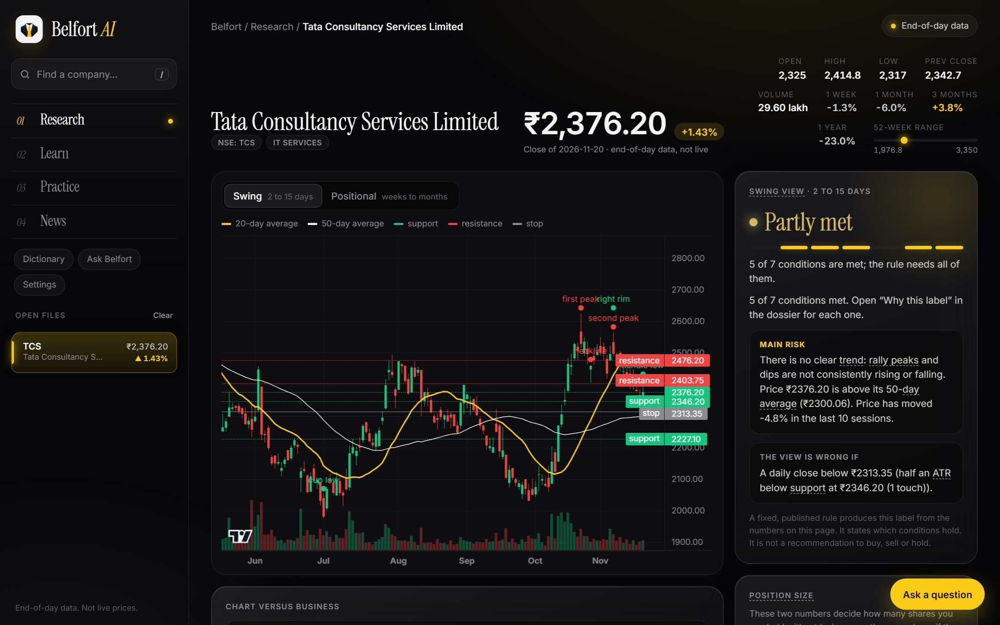

<div align="center">


# Belfort

**The practice room for Indian stocks, not the tip line.**

Belfort is a free, open-source desktop app that teaches beginners how NSE trading works, lets them practise with virtual points, and gives an explainable, rule-based read on any stock.

[](LICENSE)
[](https://www.python.org/downloads/)
[](https://github.com/sarthakviche/belfort/actions/workflows/ci.yml)
[](https://github.com/sarthakviche/belfort/releases/latest)
[](#about--key-features)
[](https://github.com/sarthakviche/belfort/releases/latest)

[**Website**](https://belfort-ai-learn.vercel.app/) · [**Run it**](#installation--quickstart) · [**Architecture**](#system-architecture) · [**Known limitations**](#known-limitations) · [**Report a Bug**](https://github.com/sarthakviche/belfort/issues/new)

<br>



</div>

---

## The problem

**First-time investors in India meet stock tips on WhatsApp, Telegram and Instagram long before they can judge them, and acting without knowing the risk is expensive:** SEBI's study found that [93% of individual futures-and-options traders lost money from FY22 to FY24](https://www.sebi.gov.in/media-and-notifications/press-releases/sep-2024/updated-sebi-study-reveals-93-of-individual-traders-incurred-losses-in-equity-fando-between-fy22-and-fy24-aggregate-losses-exceed-1-8-lakh-crores-over-three-years_86906.html), more than ₹1.8 lakh crore in all. Belfort does not cover futures and options. It works on what comes earlier: reading a tip, understanding the market and practising before money is at stake.

**AEGYTHON 2026 · Track 6: AI for Everyday Life**

| Who is stuck today | What Belfort changes |
|---|---|
| Someone who receives a "sure" tip | **Tip Check** quotes the red-flag wording back, checks NSE's surveillance lists and the price pattern, and says what to do next |
| A beginner who does not know the words | **Learn** (38 short lessons), a **dictionary** and screens in eight languages |
| Someone about to risk money untested | **Practice** with virtual points, position sizing, a journal and chart replay |
| A regular trader who wants discipline | **Research**: the same seven conditions every time, with the price that proves an idea wrong |
| Anyone lost in market news | **News** with terms explained, and an optional **AI explainer** |

---

## About & Key Features

Most people meet the market through tip groups and paid "signals". Belfort works the other way round: a short **course**, a **paper account** where mistakes cost nothing, then a **research report** whose every condition is written in plain English. It runs entirely on your own computer. There is no Belfort server, no account and no telemetry.

<table>
<tr>
<td width="33%" valign="top">

### Learn
38 lessons on a path of three stages (Beginner, Intermediate, Advanced), with multiple-choice, true or false, put-in-order and number exercises, XP, a daily streak and hearts. Charts only use prices at least 30 days old.

</td>
<td width="33%" valign="top">

### Practice
Paper trading with virtual points (a stop-loss is optional but recommended), a prediction journal scored with a Brier score, and a chart-replay trainer that hides the company and the future.

</td>
<td width="33%" valign="top">

### Research
One report per NSE stock: a seven-condition checklist, support and resistance, pattern reliability, a business check against peers, and a position size from your own risk.

</td>
</tr>
</table>

- **Deterministic labels.** The label comes from code, not a language model: same inputs, same label. A business concern can lower a label, never raise it.
- **Patterns shown, not scored.** A five-year backtest on 47 large NSE stocks found a weak, mixed edge, so patterns appear with that evidence but stay out of the label.
- **Position size rounds down.** The planned loss at your stop stays within your stated risk (a price gap can do worse).
- **Explains, never advises.** No buy, sell or hold words, no price predictions, and the app never places orders. Practice points are never redeemable.
- **Tip Check and a dictionary.** Paste a stock tip and see its red flags (registration, promised returns, surveillance lists), then optionally have Gemini search the web for SEBI actions and scam reports about it, with sources; search any market term.
- **Eight languages.** English, हिन्दी, मराठी, বাংলা, தமிழ், తెలుగు, ગુજરાતી and ಕನ್ನಡ, switchable without a reload. Translations are machine drafts for now.
- **Bring your own AI key.** Optional explainer chat with Gemini, any OpenAI-compatible service, or a local Ollama model. Replies pass the same wording filter.
- **Source and date on every figure.** Prices are end-of-day. Missing data is shown as missing.

<table>
<tr>
<td width="50%"></td>
<td width="50%"></td>
</tr>
</table>

---

## Where AI is used, and where it is not

**Rules decide. AI reads and explains.** No machine-learning model is trained or shipped with Belfort.

| Task | Done by |
|---|---|
| Tip Check's red flags and the research report's label | Plain, tested code. Same input, same answer, every reason shown |
| Chart pattern detection | Geometric rules, measured below. Not used in the label |
| Reading the text in a tip screenshot | A vision model of your choice, with your key. It only copies the text; the rules judge it, and you see what it copied |
| Ask Belfort, "Ask" in the dictionary, "Explain in your language" | A language model of your choice (Gemini, OpenAI-compatible or local Ollama), given the text on screen |
| Tip Check's "What the web says" (optional, on a button) | Gemini with Google Search and your key, or Groq (gpt-oss with web search) when there is no Gemini key or its search quota is used up: dated findings about the stock and sender, with the sources it used. It never changes the red-flag count |

**Guardrails.** A fixed system instruction (no advice, no predictions, only the figures given). Replies containing promise-style phrases are replaced; this catches listed phrases, not every form of advice. Your key stays in your browser, is sent with each request to the local server and on to your provider only, and is removed from error messages. (If you put a key in `.env` instead, it is read from that file.) Request bodies are length-limited, and screenshots are checked for type and size. There is no dedicated prompt-injection filter and no rate limiting.

**Evaluation.** Each pattern detector was run on 200 computer-drawn examples and 600 random charts, then on 47 large NSE stocks (November 2021 to November 2026) against random entry days with the same target and stop distances. It found 82% to 100% of the drawn shapes, with false alarms on 0.7% to 12.5% of random charts. On real history no pattern clearly beat random entries:

| Pattern (30 sessions) | Signals | Reached target first | Random-entry days |
|---|---|---|---|
| Double bottom | 148 | 62% | 57% (close target: reward-to-risk 0.63) |
| Double top | 147 | 36% | 43% |
| Cup and handle | 168 | 8% | 14% |
| Head and shoulders | 77 | 17% | 13% |

The test leaves out costs and uses today's large companies, which flatters results. All eight patterns are in the [pattern lesson](content/learn/lessons/pattern-evidence.md); `python scripts/run_backtest.py` reruns the test. **Not measured:** the language model's accuracy, and how many real tips Tip Check catches or misses.

---

## System Architecture

A modular monolith: one Python process, one SQLite file, one static front end with no build step. Your machine fetches the data and does the analysis.

```
 INPUT                      PROCESSING (FastAPI, 127.0.0.1)                  OUTPUT
 ─────                      ───────────────────────────────                  ──────

 Yahoo Finance (yfinance) ┐   ┌──────────────┐
 NSE end-of-day files     ├──▶│  data/       │ providers · disk cache · symbol search
 RSS feeds + RBI          ┘   └──────┬───────┘
                                     │ daily bars
          ┌──────────────┬───────────┼─────────────┬──────────────┐
          ▼              ▼           ▼             ▼              ▼
     research/        learn/      practice/       news/        assistant/
     pivots → levels  syllabus    paper engine    de-dupe      BYO-key chat
     → trend → 7      quizzes     predictions     tag + tip    (optional)
     conditions       progress    chart replay    filter
     → one label      (content/)  (SQLite)
          └──────────────┴───────────┬─────────────┴──────────────┘
                                     ▼
                        core/ compliance wording · glossary · SQLite
                                     │ JSON over /api/*
                                     ▼
              static/ HTML + CSS + JS  ──▶  pywebview window  or  any browser
                                             (Belfort.exe)      (localhost:8765)
```

**Tip Check, from input to output:**

```
 pasted text ───────────────────────┐
 screenshot ─▶ your AI model ───────┤ (copies the text only)
                                    ▼
                  tipcheck/rules.py  pure functions over phrases.json
                                    ├─ SEBI registration number
                                    ├─ NSE surveillance file   ┐ 8-second budget;
                                    └─ price and volume bars   ┘ otherwise "Not checked"
                                    ▼
                  flags with quoted evidence ─▶ next steps ─▶ safety lessons
```

Domain rules are kept apart from the web layer: `router.py` files handle HTTP, `service.py` files fetch and store, and `practice/engine.py`, `learn/engine.py` and `tipcheck/rules.py` are pure functions with no network or database.

Full details: [docs/ARCHITECTURE.md](docs/ARCHITECTURE.md) · [compliance principles](docs/COMPLIANCE.md).

---

## Tech Stack


---

## Installation & Quickstart

For the current version, use **Docker (A)** or **run from source (B)**. The downloadable Windows app (C) is older.

### Option A. Docker

With [Docker](https://docs.docker.com/get-docker/) running:

```powershell
git clone https://github.com/sarthakviche/belfort.git
cd belfort
docker build -t belfort .
docker run --rm -p 127.0.0.1:8765:8765 -v belfort-data:/data belfort
```

Open <http://localhost:8765>. Keep the `127.0.0.1:` in the port: Belfort is a single-user app, not a public service. Lint and tests run in a container too:

```powershell
docker build --target test -t belfort-test .
docker run --rm belfort-test
```

The report's pattern-reliability table comes from `data/pattern_stats.json`, which is generated, not committed. To include it, run `python scripts/run_backtest.py` (Option B setup, needs the internet) before `docker build`.

### Option B. Run from source

**Prerequisites:** [Python 3.12](https://www.python.org/downloads/) (the project pins `>=3.12,<3.13`) and Git. No API key is required.

```powershell
git clone https://github.com/sarthakviche/belfort.git
cd belfort
py -3.12 -m venv .venv
.venv\Scripts\python -m pip install -r requirements.txt
```

Open it in its own window (default port 8766):

```powershell
.venv\Scripts\python run_desktop.py
```

Or run only the server and use any browser at <http://localhost:8765>:

```powershell
.venv\Scripts\python -m uvicorn belfort.main:app --port 8765
```

On macOS or Linux use `python3.12` and `.venv/bin/python` with the `uvicorn` command (the desktop window targets Windows).

### Option C. Windows app (no Python needed, older version)

The published `Belfort.exe` is 0.2.0 beta 1 (22 November 2026). It **does not include** Tip Check, the learning path or the Indian languages.

1. Download **`Belfort.exe`** from the [latest release](https://github.com/sarthakviche/belfort/releases/latest).
2. Run it. The exe is not code-signed yet, so on the SmartScreen warning choose **More info → Run anyway**.
3. Your data is kept in `%LOCALAPPDATA%\Belfort`.

Needs Windows 10/11 with the Microsoft Edge WebView2 runtime (built into Windows 11). To verify the download, compare against `Belfort.exe.sha256` on the release page:

```powershell
Get-FileHash .\Belfort.exe -Algorithm SHA256
```

### Optional configuration

Everything works without a `.env`. To enable the Ask Belfort chat, paste your key in the app's **Settings** (kept in your browser), or copy `.env.example` to `.env`:

| Variable | Purpose |
|---|---|
| `GEMINI_API_KEY` | Google Gemini ([free key](https://aistudio.google.com/apikey)) |
| `GROQ_API_KEY` | Groq ([key](https://console.groq.com/keys)): Tip Check's web check uses it when Gemini can't search |
| `AI_PROVIDER`, `OPENAI_API_KEY`, `OPENAI_BASE_URL`, `AI_MODEL` | Any OpenAI-compatible service, or a local Ollama (no key) |
| `BELFORT_DATA_DIR` | Where the database and cache live |
| `BELFORT_PORT` | Desktop-window port (default `8766`) |
| `ACCESS_CODES` | Comma-separated codes, only for a private network you control |

### Development

```powershell
.venv\Scripts\python -m pip install -r requirements-dev.txt
.venv\Scripts\python -m pytest --cov          # offline: every network source is faked
.venv\Scripts\ruff check . ; .venv\Scripts\ruff format --check .
powershell -ExecutionPolicy Bypass -File scripts\build_windows.ps1   # builds dist\Belfort.exe
```

---

## Usage Examples

Start the server (`uvicorn` command above), then call the same JSON API the front end uses. Interactive docs are at <http://localhost:8765/api/docs>. Outputs below are real responses, trimmed; prices depend on the day.

**Find a company by name, initials or typo**

```bash
curl "http://localhost:8765/api/search?q=hdfc%20bank"
```

```json
{"results":[{"symbol":"HDFCBANK","name":"HDFC Bank","sector":"Banks"}]}
```

**Get a research report** (`style` is `swing` or `positional`; `capital` and `risk_pct` size the position)

```bash
curl "http://localhost:8765/api/analyze?symbol=TCS&style=swing&capital=100000&risk_pct=1"
```

The response holds the label (*Conditions met*, *Partly met*, *Rule excludes* or *Insufficient data*), the seven conditions, levels, patterns, the main risk and the price at which the idea is wrong.

**Size a position.** Shares are rounded down so a stop-out never exceeds your risk.

```bash
curl "http://localhost:8765/api/practice/size?symbol=TCS&stop=2380&risk_pct=1"
```

```json
{"symbol":"TCS","entry":2460.0,"stop":2380.0,"risk_pct":1.0,"quantity":125,"risk_amount":10000.0,"position_value":307500.0,"account_value":1000000.0,"over_limit":false}
```

**Place a paper trade.** A written reason is required. The stop is optional but recommended.

```bash
curl -X POST http://localhost:8765/api/practice/trades \
  -H "Content-Type: application/json" \
  -d '{"symbol":"TCS","qty":10,"stop":2380,"thesis":"Holding above the last swing low with room to resistance"}'
```

```json
{"id":1,"symbol":"TCS","status":"pending","warnings":[],"message":"Order saved. It fills at the open of the next session after 2026-11-24."}
```

Without a thesis, Belfort refuses the order and explains why, because reviewing that reason later is most of the learning:

```json
{"detail":"Write one line on why you are taking this trade (at least 10 characters). Reviewing that reason later is most of the learning."}
```

**More endpoints:** `GET /api/practice/portfolio`, `GET /api/practice/analytics`, `GET /api/practice/export/backup.json`, `GET /api/learn/syllabus`, `POST /api/learn/lessons/{id}/quiz`, `GET /api/news`, `GET /api/practice/replay/new`.

---

## Known limitations

| Area | Limitation |
|---|---|
| Tip Check | Matches listed phrases, so new wording slips past. "No flags" never means a tip is safe. How many real tips it misses has not been measured |
| SEBI registration | SEBI offers no download, so numbers are checked for shape only until you import its lists (`python -m belfort.tipcheck.register`) |
| AI features | Need your own key or a local model. Answer quality and screenshot reading accuracy have not been measured, and a successful reply from a real provider is not yet on record |
| Languages | Translations are unreviewed machine drafts. Tip Check results, report text and news stay in English. Only the Beginner lessons are translated, into Hindi |
| Data | Yahoo Finance and NSE archive files are free, unofficial, end-of-day and can change or block access |
| News | The tip-style headline filter is a pattern list and misses some phrasing. Company tags cover about 130 stocks |
| Practice | Long only, one account, end-of-day fills |
| Accounts and sync | Not available: records stay on one computer |
| Android | First version shows Belfort from your computer over Wi-Fi; only Tip Check's text checks run on the phone. Not yet tried on a device |
| Windows app | The published build is older, unsigned, and has no installer. Fonts load from Google Fonts |
| Testing | No browser tests; the front end is checked by hand. No load testing |

Full list: [docs/STATUS.md](docs/STATUS.md).

---

## Roadmap

- [x] Research reports with rule-based labels, patterns, backtested reliability and position sizing
- [x] Learn: all 38 lessons on a three-stage path with four exercise types, XP, streaks and hearts
- [x] Practice: paper account, trade journal analytics, predictions, chart replay, CSV/JSON export and restore
- [x] Tip Check, dictionary search, eight languages (machine drafts)
- [x] News from six public feeds with hover glossary; bring-your-own-key assistant
- [x] CI on Windows and Linux, Docker build, first Android version
- [ ] Measure Tip Check on a labelled set of real tips
- [ ] Fluent-speaker review of translations
- [ ] Accounts and sync; Belfort tried and finished on phones
- [ ] Replay drills linked to lessons, editable rule thresholds, watchlists
- [ ] Browser tests, accessibility pass, Windows installer and code signing

Details in [docs/ROADMAP.md](docs/ROADMAP.md), [docs/STATUS.md](docs/STATUS.md) and the [task board](docs/TASKS.md).

---

## Contributing & License

Lessons, fixes, tests and ideas are welcome. Open an [issue](https://github.com/sarthakviche/belfort/issues) first for anything not on the [task board](docs/TASKS.md), then fork, branch (`feat/T03-stock-picker`), and open a PR with a Conventional Commit title. CI must pass (lint, tests on Windows and Linux, dependency audit). A new lesson only needs a Markdown file. See [CONTRIBUTING.md](CONTRIBUTING.md) and read [docs/COMPLIANCE.md](docs/COMPLIANCE.md) before changing wording or practice rules.

Released under the [MIT License](LICENSE).

> **Disclaimer.** Belfort is an educational tool, not investment advice. It does not recommend buying, selling or holding any security, and its authors are not SEBI-registered research analysts or investment advisers. Labels describe whether a fixed rule holds and do not predict returns. Practice points have no money value and cannot be redeemed. You can lose money in the market.

<div align="center">
<br>

**Built by Sarthak Viche**

<sub>Belfort · The practice room, not the tip line</sub>

</div>
