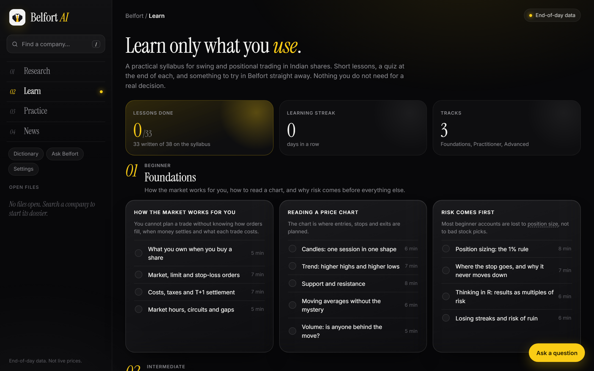
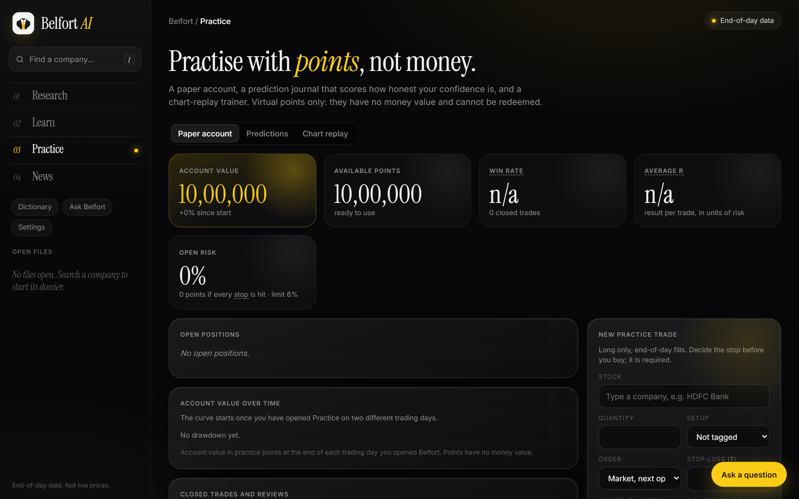

<div align="center">


# Belfort

**The practice room for Indian stocks, not the tip line.**

Belfort is a free, open-source desktop app that teaches beginners how NSE trading works, lets them practise with virtual points, and gives an explainable, rule-based read on any stock.

[](LICENSE)
[](https://www.python.org/downloads/)
[](https://github.com/sarthakviche/belfort/actions/workflows/ci.yml)
[](https://github.com/sarthakviche/belfort/releases/latest)
[](#about--key-features)
[](https://github.com/sarthakviche/belfort/releases/latest)

[**Live Demo**](https://belfort-ai-learn.vercel.app/) · [**Documentation**](docs/ABOUT.md) · [**Report a Bug**](https://github.com/sarthakviche/belfort/issues/new)

<br>


</div>

---

## About & Key Features

Most people meet the market through tip groups and paid "signals". Belfort works the other way round: a short **course**, a **paper account** where mistakes cost nothing, then a **research report** whose every condition is written in plain English. It runs entirely on your own computer. There is no Belfort server, no account and no telemetry.

<table>
<tr>
<td width="33%" valign="top">

### Learn
3 tracks, 12 modules, 38 lessons planned (33 written). Five-to-eight-minute lessons with a graded quiz, streaks, and charts that only use prices at least 30 days old.

</td>
<td width="33%" valign="top">

### Practice
Paper trading with virtual points (a stop is required), a prediction journal scored with a Brier score, and a chart-replay trainer that hides the company and the future.

</td>
<td width="33%" valign="top">

### Research
One report per NSE stock: a seven-condition checklist, support and resistance, pattern reliability, a business check against peers, and a position size from your own risk.

</td>
</tr>
</table>

- **Deterministic labels.** The label comes from code, not a language model: same inputs, same label. A business concern can lower a label, never raise it.
- **Patterns shown, not scored.** A five-year backtest on 47 large NSE stocks found a weak, mixed edge, so patterns appear with that evidence but stay out of the label.
- **Position size rounds down.** A stopped-out loss never exceeds your stated risk.
- **Explains, never advises.** No buy, sell or hold words, no price predictions, and the app never places orders. Practice points are never redeemable.
- **Bring your own AI key.** Optional explainer chat with Gemini, any OpenAI-compatible service, or a local Ollama model. Replies pass the same wording filter.
- **Source and date on every figure.** Prices are end-of-day. Missing data is shown as missing.

<table>
<tr>
<td width="50%"></td>
<td width="50%"></td>
</tr>
</table>

---

## System Architecture

A modular monolith: one Python process, one SQLite file, one static front end with no build step. Your machine fetches the data and does the analysis.

```
 INPUT                      PROCESSING (FastAPI, 127.0.0.1)                  OUTPUT
 ─────                      ───────────────────────────────                  ──────

 Yahoo Finance (yfinance) ┐   ┌──────────────┐
 NSE end-of-day files     ├──▶│  data/       │ providers · disk cache · symbol search
 RSS feeds + RBI          ┘   └──────┬───────┘
                                     │ daily bars
          ┌──────────────┬───────────┼─────────────┬──────────────┐
          ▼              ▼           ▼             ▼              ▼
     research/        learn/      practice/       news/        assistant/
     pivots → levels  syllabus    paper engine    de-dupe      BYO-key chat
     → trend → 7      quizzes     predictions     tag + tip    (optional)
     conditions       progress    chart replay    filter
     → one label      (content/)  (SQLite)
          └──────────────┴───────────┬─────────────┴──────────────┘
                                     ▼
                        core/ compliance wording · glossary · SQLite
                                     │ JSON over /api/*
                                     ▼
              static/ HTML + CSS + JS  ──▶  pywebview window  or  any browser
                                             (Belfort.exe)      (localhost:8765)
```

Full details: [docs/ARCHITECTURE.md](docs/ARCHITECTURE.md) · [compliance principles](docs/COMPLIANCE.md).

---

## Tech Stack


---

## Installation & Quickstart

### Option A. Windows app (no Python needed)

1. Download **`Belfort.exe`** from the [latest release](https://github.com/sarthakviche/belfort/releases/latest).
2. Run it. The exe is not code-signed yet, so on the SmartScreen warning choose **More info → Run anyway**.
3. Your data is kept in `%LOCALAPPDATA%\Belfort`.

Needs Windows 10/11 with the Microsoft Edge WebView2 runtime (built into Windows 11). To verify the download, compare against `Belfort.exe.sha256` on the release page:

```powershell
Get-FileHash .\Belfort.exe -Algorithm SHA256
```

### Option B. Run from source

**Prerequisites:** [Python 3.12](https://www.python.org/downloads/) (the project pins `>=3.12,<3.13`) and Git. No API key is required.

```powershell
git clone https://github.com/sarthakviche/belfort.git
cd belfort
py -3.12 -m venv .venv
.venv\Scripts\python -m pip install -r requirements.txt
```

Open it in its own window (default port 8766):

```powershell
.venv\Scripts\python run_desktop.py
```

Or run only the server and use any browser at <http://localhost:8765>:

```powershell
.venv\Scripts\python -m uvicorn belfort.main:app --port 8765
```

On macOS or Linux use `python3.12` and `.venv/bin/python` with the `uvicorn` command (the desktop window targets Windows).

### Optional configuration

Everything works without a `.env`. To enable the Ask Belfort chat, paste your key in the app's **Settings** (kept in your browser), or copy `.env.example` to `.env`:

| Variable | Purpose |
|---|---|
| `GEMINI_API_KEY` | Google Gemini ([free key](https://aistudio.google.com/apikey)) |
| `AI_PROVIDER`, `OPENAI_API_KEY`, `OPENAI_BASE_URL`, `AI_MODEL` | Any OpenAI-compatible service, or a local Ollama (no key) |
| `BELFORT_DATA_DIR` | Where the database and cache live |
| `BELFORT_PORT` | Desktop-window port (default `8766`) |
| `ACCESS_CODES` | Comma-separated codes, only for a private network you control |

### Development

```powershell
.venv\Scripts\python -m pip install -r requirements-dev.txt
.venv\Scripts\python -m pytest --cov          # offline: every network source is faked
.venv\Scripts\ruff check . ; .venv\Scripts\ruff format --check .
powershell -ExecutionPolicy Bypass -File scripts\build_windows.ps1   # builds dist\Belfort.exe
```

---

## Usage Examples

Start the server (`uvicorn` command above), then call the same JSON API the front end uses. Interactive docs are at <http://localhost:8765/api/docs>. Outputs below are real responses, trimmed; prices depend on the day.

**Find a company by name, initials or typo**

```bash
curl "http://localhost:8765/api/search?q=hdfc%20bank"
```

```json
{"results":[{"symbol":"HDFCBANK","name":"HDFC Bank","sector":"Banks"}]}
```

**Get a research report** (`style` is `swing` or `positional`; `capital` and `risk_pct` size the position)

```bash
curl "http://localhost:8765/api/analyze?symbol=TCS&style=swing&capital=100000&risk_pct=1"
```

The response holds the label (*Conditions met*, *Partly met*, *Rule excludes* or *Insufficient data*), the seven conditions, levels, patterns, the main risk and the price at which the idea is wrong.

**Size a position.** Shares are rounded down so a stop-out never exceeds your risk.

```bash
curl "http://localhost:8765/api/practice/size?symbol=TCS&stop=2380&risk_pct=1"
```

```json
{"symbol":"TCS","entry":2460.0,"stop":2380.0,"risk_pct":1.0,"quantity":125,"risk_amount":10000.0,"position_value":307500.0,"account_value":1000000.0,"over_limit":false}
```

**Place a paper trade.** A stop and a written reason are required.

```bash
curl -X POST http://localhost:8765/api/practice/trades \
  -H "Content-Type: application/json" \
  -d '{"symbol":"TCS","qty":10,"stop":2380,"thesis":"Holding above the last swing low with room to resistance"}'
```

```json
{"id":1,"symbol":"TCS","status":"pending","warnings":[],"message":"Order saved. It fills at the open of the next session after 2026-11-24."}
```

Without a thesis, Belfort refuses the order and explains why, because reviewing that reason later is most of the learning:

```json
{"detail":"Write one line on why you are taking this trade (at least 10 characters). Reviewing that reason later is most of the learning."}
```

**More endpoints:** `GET /api/practice/portfolio`, `GET /api/practice/analytics`, `GET /api/practice/export/backup.json`, `GET /api/learn/syllabus`, `POST /api/learn/lessons/{id}/quiz`, `GET /api/news`, `GET /api/practice/replay/new`.

---

## Roadmap

- [x] Research reports with rule-based labels, patterns, backtested reliability and position sizing
- [x] Learn: 33 of 38 lessons with graded quizzes and streaks
- [x] Practice: paper account, trade journal analytics, predictions, chart replay, CSV/JSON export and restore
- [x] News from six public feeds with hover glossary
- [x] Bring-your-own-key assistant
- [x] Windows `Belfort.exe` release and CI on Windows and Linux
- [ ] Remaining 5 lessons, replay drills linked to lessons, Hindi
- [ ] Editable rule thresholds and watchlists
- [ ] NSE announcements and an events calendar
- [ ] Browser tests and an accessibility pass
- [ ] Windows installer and code signing

Details in [docs/ROADMAP.md](docs/ROADMAP.md), [docs/STATUS.md](docs/STATUS.md) and the [task board](docs/TASKS.md).

---

## Contributing & License

Lessons, fixes, tests and ideas are welcome. Open an [issue](https://github.com/sarthakviche/belfort/issues) first for anything not on the [task board](docs/TASKS.md), then fork, branch (`feat/T03-stock-picker`), and open a PR with a Conventional Commit title. CI must pass (lint, tests on Windows and Linux, dependency audit). A new lesson only needs a Markdown file. See [CONTRIBUTING.md](CONTRIBUTING.md) and read [docs/COMPLIANCE.md](docs/COMPLIANCE.md) before changing wording or practice rules.

Released under the [MIT License](LICENSE).

> **Disclaimer.** Belfort is an educational tool, not investment advice. It does not recommend buying, selling or holding any security, and its authors are not SEBI-registered research analysts or investment advisers. Labels describe whether a fixed rule holds and do not predict returns. Practice points have no money value and cannot be redeemed. You can lose money in the market.

<div align="center">
<br>

**Built by Sarthak Viche**

<sub>Belfort · The practice room, not the tip line</sub>

</div>
