# Architecture

Belfort is one local application with four verticals and a shared core. Version 0.1 is a **modular monolith**: one Python process, one database file, one static front end. Every vertical has its own folder, router and tests, so it can grow (or be split out) without touching the others.

```mermaid
flowchart LR
  subgraph Browser["Browser or desktop window (static HTML, CSS, JS, no build step)"]
    R[Research] --- Lr[Learn] --- Pr[Practice] --- Nw[News]
    Gl[Dictionary hover layer]:::x
    Ai[Ask Belfort<br/>key kept in this browser]:::x
  end
  subgraph Server["Local FastAPI process (127.0.0.1)"]
    RR[research/router] --> AN[analysis engine<br/>rules, sizing, patterns]
    LR[learn/router] --> CU[curriculum<br/>Markdown lessons, quizzes]
    PR[practice/router] --> EN[settlement engine<br/>EOD fills, Brier scoring]
    NR[news/router] --> FD[feed reader<br/>RSS, tagging, tip filter]
    AR[assistant/router] --> CH[provider adapter<br/>Gemini or OpenAI-compatible]
    CORE[core: compliance wording, glossary, SQLite store]
  end
  subgraph Outside["Outside services (fetched by the user's own machine)"]
    Y[Yahoo Finance<br/>prices, statements]
    NSE[NSE archives<br/>EOD files, delivery, listings]
    RSS[Publisher and RBI RSS feeds]
    LLM[AI provider chosen by the user]
  end
  Browser -- JSON --> Server
  AN --> MK[data/market + providers + disk cache]
  EN --> MK
  CU --> MK
  MK --> Y & NSE
  FD --> RSS
  CH --> LLM
  EN & CU --> DB[(data/belfort.db)]
  classDef x fill:#222,stroke:#555
```



## Principles

1. **Local-first.** The server binds to the user's machine. Data is fetched by the user's own computer, analysis runs there, and practice records live in a local SQLite file. There is no Belfort cloud, no account and no telemetry. This keeps the project cheap to run, private by default, and on the right side of data-licence and SEBI rules (see [COMPLIANCE.md](COMPLIANCE.md)).
2. **Deterministic rules, then language.** Labels, fills and scores come from fixed code that tests can pin down. The AI assistant only explains what is already on screen, and its output passes the same wording filter as everything else.
3. **Every number has a source and a date.** Missing data is shown as missing, with the reason.
4. **Content is data.** Lessons, the syllabus and the news feed list are plain files under `content/`, so contributors can add a lesson without writing Python.
5. **No build step.** The front end is static files served by FastAPI. Anyone with Python can run, read and change it.

## Repository layout

```
belfort/
  main.py                 app factory: mounts the five routers and the static front end
  settings.py             every threshold and preset in one place
  core/
    compliance.py         banned wording, disclaimer, AI notice
    glossary.py           the dictionary behind every hover explanation
    db.py                 SQLite connection and numbered migrations
  data/
    providers.py          Yahoo and NSE archive providers (swap in a licensed feed here)
    market.py             daily bars for any vertical; lagged() for learning content
    cache.py              disk cache with time-to-live
    universe.py           built-in large caps with sectors
    symbols.py            company search index: names, initials, aliases, typos; last close per symbol
  research/               the stock report (from Belfort AI): analysis/, backtest/, screens.py, router.py
  learn/                  curriculum.py (syllabus, Markdown renderer, cards, four exercise types, grading), engine.py (pure game rules:
                          XP, streak and freezes, hearts, stage unlocks, the path), game.py (SQLite layer, locks, tests, weak spots), router.py
  practice/               engine.py (pure settlement and scoring), service.py (accounts, journal, replay), router.py
  news/                   feeds.py (RSS reader, categories, company tags, tip filter), router.py
  assistant/              chat.py (bring-your-own-key provider adapter), vision.py (screenshot to text, same keys), router.py
  tipcheck/               rules.py (pure red-flag checks), phrases.json (tip wording by language), strings.py (every
                          sentence it shows), sources.py (NSE surveillance file, SEBI register copy), register.py
                          (import SEBI's lists), service.py, router.py
  static/                 index.html, app.js (shell + research), verticals.js (practice, news, settings),
                          learn-game.js and learn-game.css (the Learn path, lesson player and rewards),
                          stock-picker.js (reusable company picker), tipcheck.js and tipcheck.css (Tip Check), mobile.js and
                          mobile.css (phone layout and the Android bridge), style.css
android/                 Belfort for Android (T48): Java shell (MainActivity, Bridge, ShareProvider, ReminderReceiver),
                          start screen and offline Tip Check in assets/, build_apk.py (no Gradle); see android/README.md
content/
  learn/syllabus.json     tracks -> modules -> lessons
  learn/lessons/*.md      one lesson per file, with a quiz block
  news/feeds.json         default feeds (users override in data/feeds.json)
  symbols/                aliases.json (nicknames -> symbols), companies.json (built-in list when NSE is unreachable)
tests/                    offline tests; no network, every source replaced by synthetic data
```

## The four verticals

| Vertical | What it does | Key design decision |
|---|---|---|
| **Research** | Per-stock report: rule checklist, levels, patterns with measured reliability, business check, position size. Screens built from published criteria. | Labels are descriptive ("Conditions met", "Partly met", "Rule excludes"), never buy or sell words. |
| **Learn** | A screened syllabus shown as a path in three stages (Beginner, Intermediate, Advanced), short lessons split into cards, exercises (multiple choice, true or false, order, number) graded on the server, XP, a daily goal, a streak with freezes, hearts and a Weak spots review, lessons that jump into Practice. Later stages are locked by the API until a stage test or the placement test is passed at 80%. | Charts in lessons only use prices at least 30 days old (`market.lagged`), following SEBI's 2026 education norms. |
| **Practice** | Paper account (long only, end-of-day fills, costs), prediction journal scored with the Brier score, chart-replay trainer on hidden historical charts. | Pure settlement engine with no I/O, so every fill rule is unit-tested. Points can never be redeemed. |
| **News** | Public RSS feeds merged, de-duplicated, categorised, tagged with companies, explained on demand. | Shows only what the feed provides and links out. Headlines that relay buy/sell calls or targets are hidden by default. |

**Tip Check** (T44) reads a forwarded stock tip and reports red flags found and not found. The text checks are pure functions over `tipcheck/phrases.json`, so they work offline and new languages are data, not code. The stock checks read NSE's daily regulatory-indicator file (`REG1_IND<ddmmyy>.csv` on nsearchives, one column per surveillance measure, 100 meaning not under it), daily bars and market value, in parallel with an eight-second budget; anything slower is shown as not checked. SEBI has no download for its adviser and analyst registers, so Belfort compares numbers with a local copy the user imports (`python -m belfort.tipcheck.register`), stored in the data folder. A screenshot is turned into text by `assistant/vision.py` with the user's own key, and the user sees that text before the rules run. The tip's own words are shown only as quoted evidence (`data-quoted-tip`); Belfort's wording lives in `tipcheck/strings.py` and is tested for banned phrases. **The web check** (T53, `tipcheck/webcheck.py`) is optional and starts only when the user presses its button: Gemini, with the user's own key and its `google_search` tool, looks for SEBI and exchange actions, scam reports and news about the stock and the sender, and returns bullet points with the pages Google used. The tip is wrapped as data in the prompt, the answer passes the banned-wording filter, and the red-flag count still comes only from the rules.

The **assistant** serves all four: the page sends the context on screen (a report, a lesson, or a news headline and description) and the mode, plus the user's own provider and key in `X-AI-*` headers.

## Data flow for one practice trade

1. The page posts `symbol, qty, stop, target, thesis` to `/api/practice/trades`.
2. `service.place_trade` validates it against the latest close and the points available, then stores it as `pending`.
3. On every portfolio read, `service.settle_all` loads new daily bars and runs `engine.settle_trade`, which replays each bar: fill at the next open (or at the limit), then stop, target, gap and close-request rules.
4. The portfolio is recomputed from the trades (cash, reserved points, marks, R multiples, win rate, average R).

## Moving from v0.1 to a production-grade product

| Concern | v0.1 | Planned |
|---|---|---|
| Install | Python and `run.bat` | Signed Windows installer (PyInstaller), then macOS and Linux packages; auto-update check against GitHub Releases |
| Data | Yahoo and NSE archive files, unofficial | Provider plugin interface, with user-keyed broker APIs (Kite Connect, Upstox) or licensed feeds; the user brings the key, as with AI |
| Storage | SQLite with numbered migrations | Same. SQLite is the right store for one user. Export and import of the practice journal (CSV, JSON) |
| Content | Markdown files in the repo | Same, plus a content linter in CI (quiz shape, banned wording, lagged charts) and translations (Hindi first) |
| Quality | 81 unit and API tests; Ruff, coverage, audit and policy checks in GitHub Actions on Windows and Linux | Browser smoke tests (Playwright), accessibility checks, release checklist |
| Hosting | None | A **static** docs and landing site only. A hosted Research service is deliberately not planned: per-stock labels served for money would fall under SEBI's research analyst rules. Hosting shared, non-personal content (lessons, news) is possible later. |

## Running in a container

The `Dockerfile` has a `test` stage (lint and the offline tests) and a final stage with only `belfort/`, `content/`, the optional pattern statistics and the pinned runtime packages. It runs as an unprivileged user and keeps data in the `/data` volume. The server listens on all interfaces inside the container, so publish the port on `127.0.0.1` only. `.dockerignore` keeps `.env` files, local databases and signing keys out of the image.

## Languages

Belfort speaks English (the default and the first choice), हिन्दी, मराठी, বাংলা, தமிழ், తెలుగు, ગુજરાતી and ಕನ್ನಡ (T50). The Android app reuses the same files.

**Catalogues** are `belfort/static/i18n/<lang>.json`, one flat JSON object per language (`en`, `hi`, `mr`, `bn`, `ta`, `te`, `gu`, `kn`):

```json
{
 "_meta": {"status": "machine-draft, needs review by a fluent speaker", "language": "hi", "name": "Hindi", "native": "हिन्दी"},
 "learn.hearts.empty": "आपके दिल खत्म हो गए हैं",
 "learn.min": "{n} मिनट"
}
```

- Keys are dot-namespaced (`nav.learn`, `learn.hearts.empty`, `pr.col_stock`, `server.locked`). Values are plain text with `{name}` placeholders; a few values carry simple HTML (`<b>`, `<em>`, `<kbd>`) and are inserted as HTML, so catalogues are trusted files in the repo, never user input.
- `en.json` is the source of truth. Other files may be partial: a missing key falls back to English, then to the key itself. Keys starting with `_` are metadata.
- Plurals: when the call passes `n` equal to 1 and a `<key>_one` exists, that is used; otherwise the plain key.
- A placeholder value that starts with `@` is itself a key (`stage="@stage.beginner"`), translated first.
- Numbers use Indian grouping (1,00,000) and Latin digits in every language, through `Intl.NumberFormat("en-IN")` (`formatNumber`, `formatMoney`). Translators keep market terms such as stop-loss, SEBI, NSE and P/E in English.
- `python -m belfort.core.i18n [lang]` reports unknown keys and changed placeholders or HTML tags; CI runs the same check in `tests/test_i18n.py`.

**Web.** `static/i18n.js` loads first. `t(key, vars, fallback)` (alias `T`), `setLanguage(lang)` (re-renders without a reload and fires `belfort:language` on `document`; app views listen and redraw), `data-i18n`, `data-i18n-html`, `data-i18n-placeholder`, `data-i18n-aria` and `data-i18n-title` for static markup, `lang` and `dir` on `<html>`. The choice is kept in `localStorage` (`belfort.lang`) and in SQLite through `GET/PUT /api/settings/language` (the `settings` table, with a `user_id` column; T43 syncs it as the non-secret key `language`). Pickers: language chips on the first-open intro and in Settings, and a select in the header. Every API call sends `X-Belfort-Lang`.

**Server.** `belfort/core/i18n.py` reads the same catalogues for server messages (`tr(lang, key, **vars)`), sets the request language from `X-Belfort-Lang`, `?lang=` or `Accept-Language` (a small ASGI middleware), and builds the "Reply in <language>." sentence that Ask Belfort and the dictionary's Ask add to their question. Errors that carry a catalogue key (locked stage, out of hearts) are said in the learner's language and send the key in an `X-Error-Key` header so the page does not have to match words.

**Lessons.** `content/learn/lessons/<lang>/<id>.md` has the same format and the same quiz structure and answers as the English file, with only the text translated and `translation: machine-draft` in the front matter. The API serves it when the request language matches and falls back to the English file otherwise (the response says `translated`); the page then offers "Explain in <language>", which asks the existing assistant to explain the current card, labelled as AI. Grading uses the same language as the text that was shown. Beginner lessons (16) ship in Hindi.

**Compliance.** Banned promise-style phrases for a language are data in `content/compliance/banned.<lang>.json` (Hindi so far), loaded by `core/i18n.py`; `core/compliance.py` is unchanged. The lesson tests run that list on every translated lesson, and an AI answer containing one is replaced. Changes to compliance wording need Sarthak's review.

**Not translated yet.** Text that the Python engines write (verdicts, rule explanations, chart reading, glossary meanings, news headlines, practice notes) is still English; labels, headings, tables, buttons and all messages around them are translated.

## Extension points for contributors

- **A new lesson:** add `content/learn/lessons/<id>.md` and remove `"status": "planned"` for it in `syllabus.json`. The tests check the quiz, the wording and the format.
- **A new data source:** implement the methods of `YahooProvider` or `NseArchiveProvider` and swap the instance in `research/analysis/pipeline.py`.
- **A new feed:** add it to `content/news/feeds.json`.
- **A new AI provider:** most services speak the OpenAI chat format already; otherwise add a branch in `assistant/chat.py::_call`.
- **A new rule or indicator:** add it under `research/analysis/`, put every threshold in `settings.py`, and add tests on synthetic data.
