# Architecture

Belfort is one local application with four verticals and a shared core. Version 0.1 is a **modular monolith**: one Python process, one database file, one static front end. Every vertical has its own folder, router and tests, so it can grow (or be split out) without touching the others.

```mermaid
flowchart LR
  subgraph Browser["Browser or desktop window (static HTML, CSS, JS, no build step)"]
    R[Research] --- Lr[Learn] --- Pr[Practice] --- Nw[News]
    Gl[Dictionary hover layer]:::x
    Ai[Ask Belfort<br/>key kept in this browser]:::x
  end
  subgraph Server["Local FastAPI process (127.0.0.1)"]
    RR[research/router] --> AN[analysis engine<br/>rules, sizing, patterns]
    LR[learn/router] --> CU[curriculum<br/>Markdown lessons, quizzes]
    PR[practice/router] --> EN[settlement engine<br/>EOD fills, Brier scoring]
    NR[news/router] --> FD[feed reader<br/>RSS, tagging, tip filter]
    AR[assistant/router] --> CH[provider adapter<br/>Gemini or OpenAI-compatible]
    CORE[core: compliance wording, glossary, SQLite store]
  end
  subgraph Outside["Outside services (fetched by the user's own machine)"]
    Y[Yahoo Finance<br/>prices, statements]
    NSE[NSE archives<br/>EOD files, delivery, listings]
    RSS[Publisher and RBI RSS feeds]
    LLM[AI provider chosen by the user]
  end
  Browser -- JSON --> Server
  AN --> MK[data/market + providers + disk cache]
  EN --> MK
  CU --> MK
  MK --> Y & NSE
  FD --> RSS
  CH --> LLM
  EN & CU --> DB[(data/belfort.db)]
  classDef x fill:#222,stroke:#555
```



## Principles

1. **Local-first.** The server binds to the user's machine. Data is fetched by the user's own computer, analysis runs there, and practice records live in a local SQLite file. There is no Belfort cloud, no account and no telemetry. This keeps the project cheap to run, private by default, and on the right side of data-licence and SEBI rules (see [COMPLIANCE.md](COMPLIANCE.md)).
2. **Deterministic rules, then language.** Labels, fills and scores come from fixed code that tests can pin down. The AI assistant only explains what is already on screen, and its output passes the same wording filter as everything else.
3. **Every number has a source and a date.** Missing data is shown as missing, with the reason.
4. **Content is data.** Lessons, the syllabus and the news feed list are plain files under `content/`, so contributors can add a lesson without writing Python.
5. **No build step.** The front end is static files served by FastAPI. Anyone with Python can run, read and change it.

## Repository layout

```
belfort/
  main.py                 app factory: mounts the five routers and the static front end
  settings.py             every threshold and preset in one place
  core/
    compliance.py         banned wording, disclaimer, AI notice
    glossary.py           the dictionary behind every hover explanation
    db.py                 SQLite connection and numbered migrations
  data/
    providers.py          Yahoo and NSE archive providers (swap in a licensed feed here)
    market.py             daily bars for any vertical; lagged() for learning content
    cache.py              disk cache with time-to-live
    universe.py           built-in large caps with sectors
  research/               the stock report (from Belfort AI): analysis/, backtest/, screens.py, router.py
  learn/                  curriculum.py (syllabus, Markdown renderer, quizzes, streaks), router.py
  practice/               engine.py (pure settlement and scoring), service.py (accounts, journal, replay), router.py
  news/                   feeds.py (RSS reader, categories, company tags, tip filter), router.py
  assistant/              chat.py (bring-your-own-key provider adapter), router.py
  static/                 index.html, app.js (shell + research), verticals.js (learn, practice, news, settings), style.css
content/
  learn/syllabus.json     tracks -> modules -> lessons
  learn/lessons/*.md      one lesson per file, with a quiz block
  news/feeds.json         default feeds (users override in data/feeds.json)
tests/                    81 tests; no network, every source replaced by synthetic data
```

## The four verticals

| Vertical | What it does | Key design decision |
|---|---|---|
| **Research** | Per-stock report: rule checklist, levels, patterns with measured reliability, business check, position size. Screens built from published criteria. | Labels are descriptive ("Conditions met", "Partly met", "Rule excludes"), never buy or sell words. |
| **Learn** | A screened syllabus in three tracks, short lessons, quizzes graded on the server, streaks, lessons that jump into Practice. | Charts in lessons only use prices at least 30 days old (`market.lagged`), following SEBI's 2026 education norms. |
| **Practice** | Paper account (long only, end-of-day fills, costs), prediction journal scored with the Brier score, chart-replay trainer on hidden historical charts. | Pure settlement engine with no I/O, so every fill rule is unit-tested. Points can never be redeemed. |
| **News** | Public RSS feeds merged, de-duplicated, categorised, tagged with companies, explained on demand. | Shows only what the feed provides and links out. Headlines that relay buy/sell calls or targets are hidden by default. |

The **assistant** serves all four: the page sends the context on screen (a report, a lesson, or a news headline and description) and the mode, plus the user's own provider and key in `X-AI-*` headers.

## Data flow for one practice trade

1. The page posts `symbol, qty, stop, target, thesis` to `/api/practice/trades`.
2. `service.place_trade` validates it against the latest close and the points available, then stores it as `pending`.
3. On every portfolio read, `service.settle_all` loads new daily bars and runs `engine.settle_trade`, which replays each bar: fill at the next open (or at the limit), then stop, target, gap and close-request rules.
4. The portfolio is recomputed from the trades (cash, reserved points, marks, R multiples, win rate, average R).

## Moving from v0.1 to a production-grade product

| Concern | v0.1 | Planned |
|---|---|---|
| Install | Python and `run.bat` | Signed Windows installer (PyInstaller), then macOS and Linux packages; auto-update check against GitHub Releases |
| Data | Yahoo and NSE archive files, unofficial | Provider plugin interface, with user-keyed broker APIs (Kite Connect, Upstox) or licensed feeds; the user brings the key, as with AI |
| Storage | SQLite with numbered migrations | Same. SQLite is the right store for one user. Export and import of the practice journal (CSV, JSON) |
| Content | Markdown files in the repo | Same, plus a content linter in CI (quiz shape, banned wording, lagged charts) and translations (Hindi first) |
| Quality | 81 unit and API tests; Ruff, coverage, audit and policy checks in GitHub Actions on Windows and Linux | Browser smoke tests (Playwright), accessibility checks, release checklist |
| Hosting | None | A **static** docs and landing site only. A hosted Research service is deliberately not planned: per-stock labels served for money would fall under SEBI's research analyst rules. Hosting shared, non-personal content (lessons, news) is possible later. |

## Extension points for contributors

- **A new lesson:** add `content/learn/lessons/<id>.md` and remove `"status": "planned"` for it in `syllabus.json`. The tests check the quiz, the wording and the format.
- **A new data source:** implement the methods of `YahooProvider` or `NseArchiveProvider` and swap the instance in `research/analysis/pipeline.py`.
- **A new feed:** add it to `content/news/feeds.json`.
- **A new AI provider:** most services speak the OpenAI chat format already; otherwise add a branch in `assistant/chat.py::_call`.
- **A new rule or indicator:** add it under `research/analysis/`, put every threshold in `settings.py`, and add tests on synthetic data.
